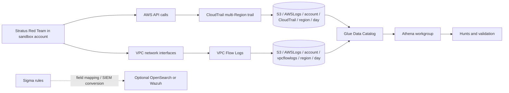

# Cloud Detection Lab

An AWS detection engineering lab built around **CloudTrail management events**, **VPC Flow Logs**, **Amazon S3**, **Athena**, **Sigma**, and **Stratus Red Team**. It covers collection, schema, attack emulation, detection logic, hunting, triage, and validation. The repository is a deployable runbook and rule set; it does **not** claim an AWS detonation or measured alert outcome without accompanying evidence.

## Scope and status

| Component | Coverage |
|---|---|
| Control plane | Multi-Region CloudTrail trail with read and write management events delivered to S3 |
| Network plane | VPC Flow Logs delivered to S3 in the default 14-field text format |
| Query plane | Athena external tables with partition projection; no standing search cluster |
| Emulation | Stratus Red Team: administrative IAM user and denied EC2 password retrieval |
| Detection | Two Sigma detections and equivalent Athena hunting queries |
| Validation | Schema/rule checks are local; live AWS validation is an explicit remaining step |

**Detection boundary:** CloudTrail management events capture the IAM and EC2 API calls used here. VPC Flow Logs record traffic at network interfaces, not the IAM API request body or the success of an AWS API call. S3 object reads require CloudTrail **data events**, which this baseline does not enable. Accordingly, this repository does not claim to detect T1530 or data exfiltration.

## Architecture and data flow



Athena reads objects in S3 through external table definitions; it does **not** index them. An optional OpenSearch or Wazuh deployment needs a separate delivery and normalization pipeline, field mapping, alert schedule, and access controls. Sigma is portable detection logic, not an Athena execution engine. The SQL files are the executable Athena equivalents.

### Collection contract

1. Use a **dedicated sandbox AWS account**, a dedicated log bucket, and a separate Athena results bucket or prefix. Set a budget alarm and finite retention before emulation.
2. Configure one **multi-Region CloudTrail trail**, management events set to **read and write**, and delivery to S3. Enable log file validation. Protect the log bucket with Block Public Access, encryption, versioning, least-privilege bucket policy, and restricted deletion. For stronger tamper resistance, consider Object Lock with an appropriate retention policy.
3. Create VPC Flow Logs for the relevant VPC or subnets with destination S3, aggregation interval supported by the environment, default record format, and `ACCEPT` plus `REJECT` traffic. The schema in this repo assumes default **text**, non-Hive S3 paths, and daily partitions. If you choose Parquet, custom fields, Hive-compatible prefixes, or hourly partitions, use a matching table definition.
4. Create an Athena database and workgroup. Encrypt query results, restrict workgroup and S3 access, and cap bytes scanned. Run [CloudTrail DDL](athena/01_cloudtrail.sql) and [VPC Flow Logs DDL](athena/02_vpc_flow_logs.sql) after replacing placeholders.
5. Confirm a benign `sts:GetCallerIdentity` event in CloudTrail and inspect an S3 log object before running the attack scenarios. CloudTrail delivery and VPC log publication are asynchronous.

Example S3 layout (replace account, bucket, and Region):

```text
s3://<LOG_BUCKET>/AWSLogs/<ACCOUNT_ID>/CloudTrail/<REGION>/YYYY/MM/DD/*.json.gz
s3://<LOG_BUCKET>/AWSLogs/<ACCOUNT_ID>/vpcflowlogs/<REGION>/YYYY/MM/DD/*.log.gz
```

**IAM endpoint caveat:** IAM is a global service. Include global service events in the trail and inspect the Region used in delivered IAM records; do not assume that the API caller's local Region is where the IAM event is stored. The supplied CloudTrail DDL is **one account and one Region per table**. Create another table per delivered Region or extend the projection for multi-Region hunting. A missing Region produces a false negative.

## Repository map

```text
.
├── README.md
├── athena/
│   ├── 01_cloudtrail.sql
│   ├── 02_vpc_flow_logs.sql
│   ├── 10_iam_admin_policy_hunt.sql
│   ├── 20_ec2_password_spray_hunt.sql
│   └── 30_vpc_network_context.sql
├── detections/
│   ├── aws_iam_administrator_access_attached.yml
│   └── aws_ec2_password_data_denied_burst.yml
└── docs/
    ├── attack-simulation.md
    └── detection-writeup.md
```

## Attack simulation

See the [execution runbook](docs/attack-simulation.md). The two techniques are:

| Stratus technique | Expected management events | ATT&CK mapping | Detection |
|---|---|---|---|
| `aws.persistence.iam-create-admin-user` | `CreateUser`, `AttachUserPolicy`, `CreateAccessKey` | [T1136.003](https://attack.mitre.org/techniques/T1136/003/) for account creation; [T1098.003](https://attack.mitre.org/techniques/T1098/003/) for added cloud privileges; [T1098.001](https://attack.mitre.org/techniques/T1098/001/) if an access key is created | Alert on attachment of AWS `AdministratorAccess`; hunt for adjacent creation and key issuance |
| `aws.credential-access.ec2-get-password-data` | `AssumeRole`, repeated `GetPasswordData` with `Client.UnauthorizedOperation` | [T1552](https://attack.mitre.org/techniques/T1552/) at the parent technique level for attempted credential retrieval | Alert on >=5 denied calls by one principal in 5 minutes |

The second Stratus technique intentionally uses fictitious instance IDs and a role without `ec2:GetPasswordData` permission. It tests **denied probing**, not successful RDP password access. `T1530` would require an S3 object access scenario and CloudTrail S3 data events, so it is deliberately not assigned to either rule.

## Detection engineering

The [IAM rule](detections/aws_iam_administrator_access_attached.yml) matches successful `AttachUserPolicy` calls assigning the AWS-managed `AdministratorAccess` policy. It is high signal, but legitimate provisioning can match. The rule does not require a Stratus user agent or test account name, which keeps it useful outside the lab.

The [EC2 rule](detections/aws_ec2_password_data_denied_burst.yml) is a Sigma **correlation rule** in a two-document YAML file: a base event selector plus a five-minute event count grouped by `userIdentity.arn`. The base selector is intentionally not emitted as a stand-alone alert. Conversion requires a Sigma backend that supports correlations and nested CloudTrail field mapping. If the SIEM cannot support this rule, implement the equivalent windowed query in [Athena](athena/20_ec2_password_spray_hunt.sql).

Both rules carry Sigma `status: test` until they pass live AWS and target-SIEM validation. The logic is ready for review and deployment with the documented field mapping and tuning, but the repository makes no unmeasured production reliability claim.

Alert routing recommendations: IAM administrator attachment → high severity and immediate analyst review; denied password burst → medium severity and investigate principal, source IP, target instances, adjacent `AssumeRole`, and any successful `GetPasswordData`. Deduplicate on `eventID`; tune known provisioning identities by exact principal and change window, not by globally suppressing the API operation.

## Threat hunting and validation

Run the [IAM hunt](athena/10_iam_admin_policy_hunt.sql) and [EC2 burst hunt](athena/20_ec2_password_spray_hunt.sql) with a narrow day partition. SQL returns investigation context, including principal, source IP, user agent, target, error, and event IDs. The [VPC query](athena/30_vpc_network_context.sql) is supporting context for instance network traffic; it cannot prove an AWS API call or exfiltration. Read the [write-up](docs/detection-writeup.md) for hypotheses, interpretation, false positives, and acceptance criteria.

For each run, retain sanitized evidence outside the public repository: UTC test window, AWS account alias, trail/flow-log configuration, S3 object key, Athena query ID, rows scanned, matched event IDs, Sigma conversion output, alert screenshot or ID, cleanup output, and a result table. Redact account IDs, access keys, source addresses, password data, and sensitive resource names before publishing. No live-run results are included here.

## Operational limitations

- CloudTrail S3 delivery and Athena hunts are **batch** detection. A production paging path needs a streaming CloudTrail route (for example, EventBridge or CloudWatch Logs), measured ingestion latency, and alert delivery.
- A single API event is evidence of a call, not proof of compromise. `GetPasswordData` denied events are attempts; an `AttachUserPolicy` event must be checked for `errorCode` and the actor's authorization context.
- CloudTrail management events do not show S3 `GetObject` unless S3 data events are explicitly configured. VPC Flow Logs do not include payloads and may use aggregation or `SKIPDATA`; join on interface/instance and time with care.
- Partition pruning requires the `day` predicate in each Athena query. Use the correct account/Region, maintain S3 retention, and review scan cost.
- No AWS account, SIEM, paid service, or live attack execution is provisioned by this repository.

## Primary references

- [AWS: CloudTrail table with partition projection](https://docs.aws.amazon.com/athena/latest/ug/create-cloudtrail-table-partition-projection.html)
- [AWS: VPC Flow Logs in Athena with partition projection](https://docs.aws.amazon.com/athena/latest/ug/vpc-flow-logs-partition-projection.html)
- [AWS: CloudTrail management and data event selectors](https://docs.aws.amazon.com/awscloudtrail/latest/userguide/logging-data-events-with-cloudtrail.html)
- [Stratus: administrative IAM user](https://stratus-red-team.cloud/attack-techniques/AWS/aws.persistence.iam-create-admin-user/)
- [Stratus: EC2 password data](https://stratus-red-team.cloud/attack-techniques/AWS/aws.credential-access.ec2-get-password-data/)
- [Sigma: correlation rules](https://sigmahq.io/docs/meta/correlations.html)

## License

Documentation and detection content are released under the [MIT License](LICENSE). Run attack emulation only in an account you control.
